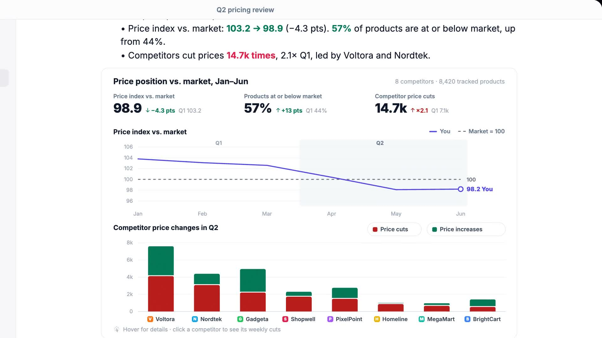
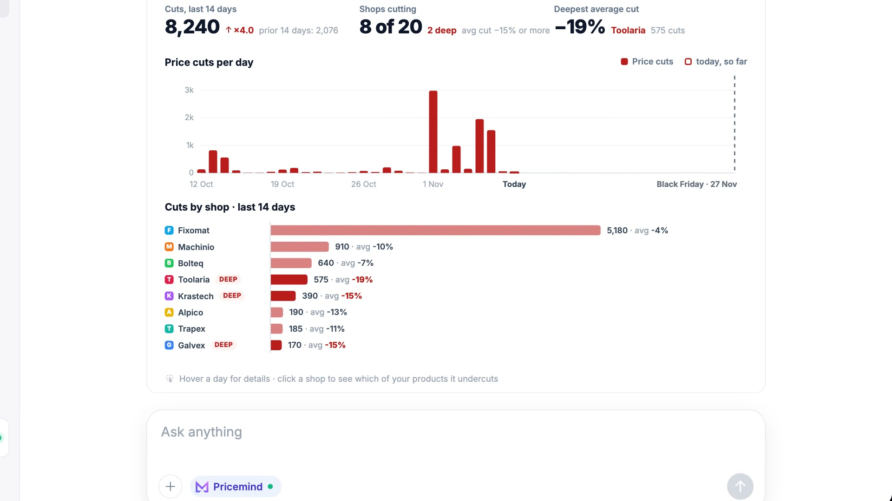

<p align="center">
  
</p>

<h1 align="center">Pricemind for Claude and Codex</h1>

<p align="center">
  <strong>Live market prices, in every conversation.</strong><br>
  Ask about your prices and competitors in plain language. The answer comes from your Pricemind data, drawn as a Pricemind chart.
</p>

<p align="center">
  <a href="https://github.com/pricemind/agent-plugins/releases/download/v1.0.0/pricemind-mcp-chat.mp4">
    
  </a>
  <br>
  <sub>▶ <a href="https://github.com/pricemind/agent-plugins/releases/download/v1.0.0/pricemind-mcp-chat.mp4">Watch with sound</a> · demo data</sub>
</p>

The official [Pricemind](https://pricemind.ai) plugin for AI assistants. It connects Claude or Codex to your Pricemind account, so you can ask about your prices and competitors in plain language, get the answer as a Pricemind chart, and act on it.

One plugin, one source: the same skills and the same connection work in Claude and in Codex.

## See it in action

| Own brand vs. market | Q2 management review | Black Friday watch |
|---|---|---|
| [](https://github.com/pricemind/agent-plugins/releases/download/v1.0.0/pricemind-mcp-chat.mp4) | [](https://github.com/pricemind/agent-plugins/releases/download/v1.0.0/pricemind-mcp-report.mp4) | [](https://github.com/pricemind/agent-plugins/releases/download/v1.0.0/pricemind-mcp-blackfriday.mp4) |
| "How do our own-brand prices compare with the cheapest alternatives on the market?" | "Prepare the Q2 pricing review for Monday's management meeting." | "Have our competitors started cutting prices already? Show me who, how deep, and since when." |

<sub>The videos use fictional demo data.</sub>

## What you get

**Charts that look like Pricemind.** Price positions, price histories, competitor moves and price ladders come back as Pricemind charts you can explore: hover for values, show or hide shops, switch between chart and table.

- In the **Claude apps** (web and desktop) the chart opens interactively inside the chat.
- In **Claude Code** and **Codex**, the assistant fills a ready-made Pricemind chart page from the plugin and opens it in your browser. It looks the same, and the assistant writes no chart code.

**Quiet approvals.** The assistant asks at most once per job, never once per step:

| What it does | Examples | Does it ask? |
|---|---|---|
| Reads | search, price history, match context | Never |
| Adds or changes something reversible | approve matches, attach offers, start a crawl or run | No: it does what you asked, then reports what changed and how to undo it |
| Removes something or moves prices | unmatch, detach, remove a comparison product, create or change a pricing strategy | Once, for the whole plan, then it runs to the end. If your request already spells out the exact change, that is the approval |
| Pricemind flags a problem | a material warning, data changed since the plan, wider scope than asked | Only then does it stop mid-job |

Every change is reported at the end, with how to undo it.

Your client may still show its own permission prompt when the assistant calls a tool that changes data: one prompt per call, and a call can carry up to 25 changes. The `setup` skill can allow the read-only tools so lookups never prompt.

**Workflows in one request.** Run a whole pricing workflow by name or just ask the question.

## Skills

| Skill | Ask, for example |
|---|---|
| `setup` | "Get me started with Pricemind." Checks your sign-in, finds your channels and suggests first questions for your data. |
| `price-intelligence` | "Which of my Bosch drills are more expensive than at Shop X?", "Who changed prices on coffee machines this week?" |
| `price-check` | "Price check SKU 12345: every competitor's price, stock and history." |
| `weekly-review` | "Run my weekly pricing review." Price moves, lost and gained positions, new out-of-stocks, top 10 products to act on. |
| `management-report` | "Prepare the Q2 pricing review for Monday's management meeting." |
| `promo-watch` | "Have competitors started cutting prices? Show who, how deep and since when." |
| `own-brand-vs-market` | "How do our own-brand prices compare with the cheapest alternatives?" |
| `matching-review` | "Find competitor offers matched to the wrong product and fix them." |
| `competitor-alternatives` | "Find comparable models from other brands for this drill and add them as comparison products." |
| `pricing-strategies` | "Explain my repricing strategies and lower the margin floor for garden tools to 12%." |

In Claude, run a skill by name with `/pricemind:<skill>` (for example `/pricemind:weekly-review`). In Codex, type `$` and pick the Pricemind skill. In both, a plain question is enough: the assistant picks the right skill itself.

## Claude Code

Install:

```bash
claude plugin marketplace add pricemind/agent-plugins
```

```bash
claude plugin install pricemind@pricemind
```

Or, inside a session, run `/plugin marketplace add pricemind/agent-plugins`, then `/plugin install pricemind@pricemind`.

Sign in: in a session, run `/mcp`, choose the Pricemind server and select **Authenticate**. **Sign in with Pricemind** opens in your browser. Then run `/pricemind:setup`.

Charts open as a Pricemind chart page in your browser.

## Claude apps (web and desktop)

Add Pricemind from the Claude connector directory once it is listed, or install the plugin as above. Then connect Pricemind in the connector's settings; **Sign in with Pricemind** opens in your browser.

Charts open interactively inside the chat.

## Codex (preview)

Codex support is new in 1.1. Installing the plugin is verified with the Codex CLI; sign-in, the skills and the chart page are still being tested in Codex, so please report anything that behaves differently from Claude.

Install:

```bash
codex plugin marketplace add pricemind/agent-plugins
```

```bash
codex plugin add pricemind@pricemind
```

Sign in:

```bash
codex mcp login pricemind
```

**Sign in with Pricemind** opens in your browser. Then ask Codex to run `$setup`.

Charts open as a Pricemind chart page in your browser.

## Sign-in and permissions

You need:

- a Pricemind account;
- an account administrator role (connecting an app acts for the whole account).

On the consent page, choose what the assistant may do:

- **Read and make changes** (default): read everything, plus run crawls and matching, approve matches and edit pricing strategies. It asks before removing things or changing prices, and reports every change it makes.
- **Read only**: products, competitor prices, price history, matches and pricing strategies. No changes.

No API key is stored in the plugin or on your computer. Pricemind issues a short-lived access token and renews it automatically. You can disconnect an assistant at any time in Pricemind under **Profile → Security → Connected AI apps**, and access stops immediately.

## What's inside

| Part | What it does |
|---|---|
| `.mcp.json`, `mcp.json` | Connect to the Pricemind MCP server at `https://mcp.pricemind.io/mcp` (`.mcp.json` for Claude and older Codex builds, `mcp.json` for the Agent Plugins layout). |
| `.claude-plugin/` | Claude plugin manifest and marketplace. |
| `plugin.json`, `.codex-plugin/`, `.agents/plugins/` | Codex manifest (Agent Plugins layout, with the older `.codex-plugin` layout as a fallback) and marketplace. |
| `skills/<name>/SKILL.md` | The ten skills above. Plain instructions, the same for every client. |
| `skills/<name>/agents/openai.yaml` | Display names and the server dependency for Codex. |
| `skills/price-intelligence/assets/` | The Pricemind chart page the assistant fills in where the chat cannot show charts itself. |
| `assets/` | The logo, the demo GIF and the video posters shown in this README. |
| `scripts/`, `tools.lock.json` | Repository checks only: manifest consistency and a check that every tool a skill names exists on the server. They are not part of what the assistant runs. |

The plugin runs no code on your machine. It adds the connection above, the skills and the chart page.

## Data and privacy

- **What the assistant sends:** when you use the plugin, the assistant sends the requests it makes on your behalf, such as search filters, product IDs and changes you asked for, to Pricemind at `mcp.pricemind.io`.
- **What Pricemind returns:** data from your own Pricemind account.
- **What the plugin itself does:** it collects nothing and contacts no other service. The chart page loads no external code.
- **Policies:** Pricemind processes your data under its [Privacy Policy](https://pricemind.ai/privacy) and [Terms](https://pricemind.ai/terms).

## Development

```bash
claude plugin validate --strict .
```

```bash
node scripts/check-manifests.mjs
```

```bash
node scripts/check-tool-names.mjs
```

Set `PRICEMIND_MCP_TOKEN` to also check tool names against the live server, and run `node scripts/update-tools-lock.mjs` after the server's tools change. CI runs all three on every push. See [CHANGELOG.md](CHANGELOG.md) for releases.

## Support

Questions or problems: [pricemind.ai/contact](https://pricemind.ai/contact). Documentation: [pricemind.ai/docs](https://pricemind.ai/docs).

## License

[MIT](LICENSE)
