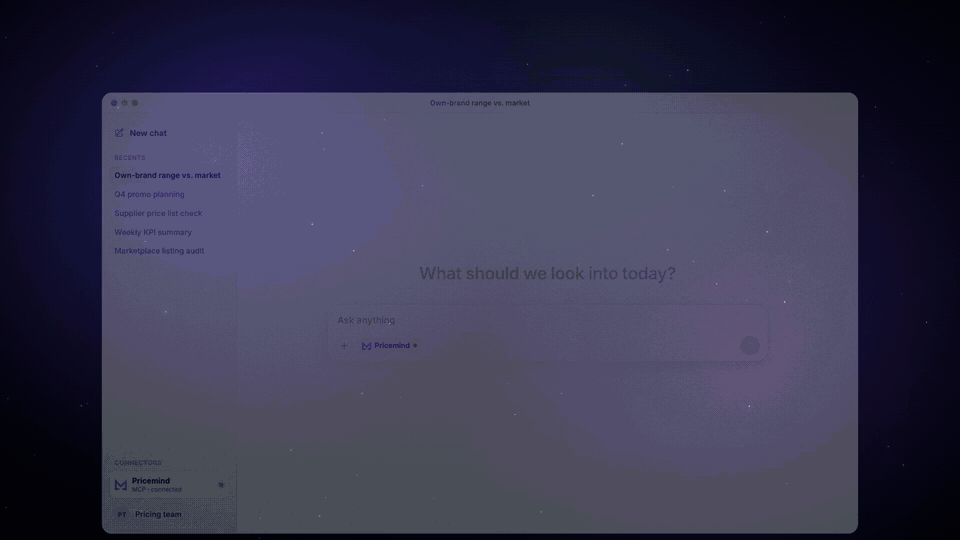
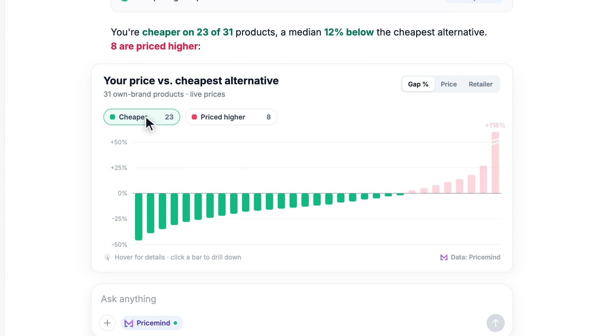

<p align="center">
  
</p>

<h1 align="center">Pricemind for Claude</h1>

<p align="center">
  <strong>Live market prices, in every conversation.</strong><br>
  Ask Claude about your prices and competitors in plain language. It answers from your Pricemind data and draws the charts in the chat.
</p>

<p align="center">
  <a href="https://github.com/pricemind/agent-plugins/releases/download/v1.0.0/pricemind-mcp-chat.mp4">
    
  </a>
  <br>
  <sub>▶ <a href="https://github.com/pricemind/agent-plugins/releases/download/v1.0.0/pricemind-mcp-chat.mp4">Watch with sound</a> · demo data</sub>
</p>

The official [Pricemind](https://pricemind.ai) plugin for Claude. It connects Claude to your Pricemind account, so you can ask about your prices and competitors in plain language and act on the answers.

## See it in action

| Own brand vs. market | Q2 management review | Black Friday watch |
|---|---|---|
| [](https://github.com/pricemind/agent-plugins/releases/download/v1.0.0/pricemind-mcp-chat.mp4) | [](https://github.com/pricemind/agent-plugins/releases/download/v1.0.0/pricemind-mcp-report.mp4) | [](https://github.com/pricemind/agent-plugins/releases/download/v1.0.0/pricemind-mcp-blackfriday.mp4) |
| "How do our own-brand prices compare with the cheapest alternatives on the market?" | "Prepare the Q2 pricing review for Monday's management meeting." | "Have our competitors started cutting prices already? Show me who, how deep, and since when." |

<sub>The videos use fictional demo data.</sub>

## What you can do

- **Price intelligence**: "Which of my Bosch drills are more expensive than at Shop X?", "Who changed prices on coffee machines this week?", "Show the price history of SKU 12345."
- **Matching review**: find and fix competitor listings that are matched to the wrong product. Claude shows a preview before any change.
- **Competitor alternatives**: research comparable models from other brands and add them as comparison products under your own product.
- **Pricing strategies**: understand your repricing rules, draft new ones and change them safely. Claude previews every change before applying it.

## What's inside

| Part | What it does |
|---|---|
| `.mcp.json` | Connects to the Pricemind MCP server at `https://mcp.pricemind.io/mcp`. |
| `skills/price-intelligence` | How to answer pricing questions with Pricemind search. |
| `skills/matching-review` | A safe review-preview-apply workflow for product matches. |
| `skills/competitor-alternatives` | Research and recording of cross-brand comparable products. |
| `skills/pricing-strategies` | Inspecting and safely changing repricing strategies. |
| `assets/` | The demo GIF and video posters shown in this README. Claude does not load them. |

The plugin contains no code that runs on your machine. It only adds the connection above and these instructions.

## Install

In Claude Code:

```bash
claude plugin marketplace add pricemind/agent-plugins
```

```bash
claude plugin install pricemind@pricemind
```

Or, inside a Claude Code session, run `/plugin marketplace add pricemind/agent-plugins`, then `/plugin install pricemind@pricemind`.

## Sign in

After installing, sign in once. In Claude Code, run `/mcp`, choose the Pricemind server and select **Authenticate**. In the Claude apps, connect Pricemind from the connector's settings. Either way, **Sign in with Pricemind** opens in your browser. You need:

- a Pricemind account;
- an account administrator role (connecting an app acts for the whole account).

On the consent page, choose what Claude may do:

- **Read and make changes** (default): read everything, plus run crawls and matching, approve matches and edit pricing strategies. Claude previews every change.
- **Read only**: products, competitor prices, price history, matches and pricing strategies. No changes.

No API key is stored in the plugin or on your computer. Pricemind issues a short-lived access token and renews it automatically. You can disconnect Claude at any time in Pricemind under **Profile → Security → Connected AI apps**, and access stops immediately.

## Data and privacy

- **What Claude sends:** when you use the plugin, Claude sends the requests it makes on your behalf, such as search filters, product IDs and approved changes, to Pricemind at `mcp.pricemind.io`.
- **What Pricemind returns:** data from your own Pricemind account.
- **What the plugin itself does:** it collects nothing and contacts no other service.
- **Policies:** Pricemind processes your data under its [Privacy Policy](https://pricemind.ai/privacy) and [Terms](https://pricemind.ai/terms).

## Support

Questions or problems: [pricemind.ai/contact](https://pricemind.ai/contact). Documentation: [pricemind.ai/docs](https://pricemind.ai/docs).

## License

[MIT](LICENSE)
